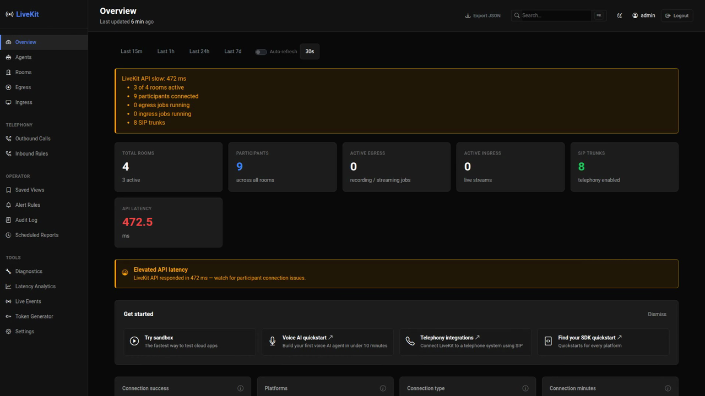
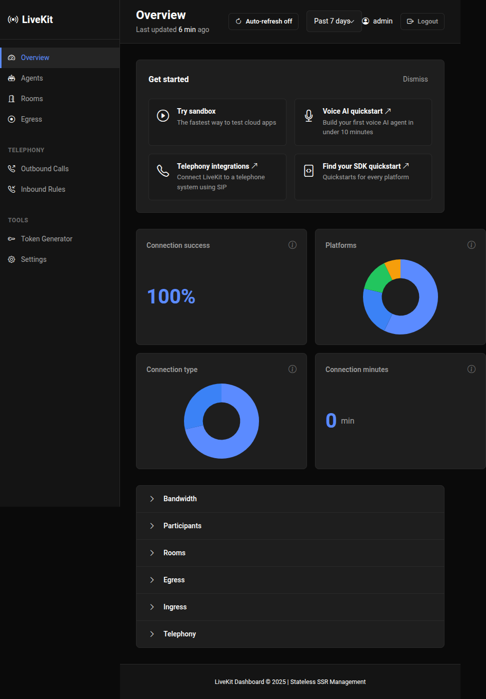
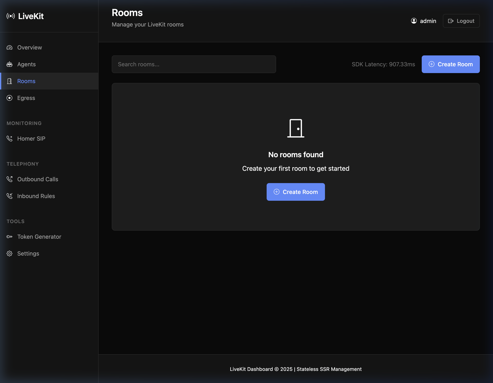
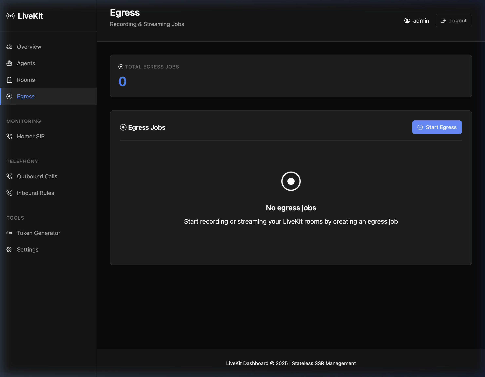
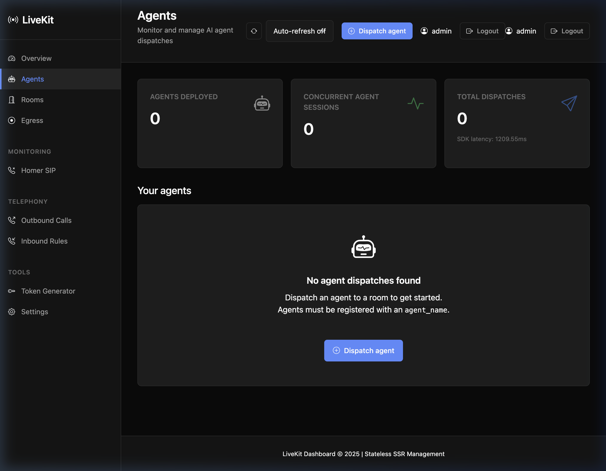
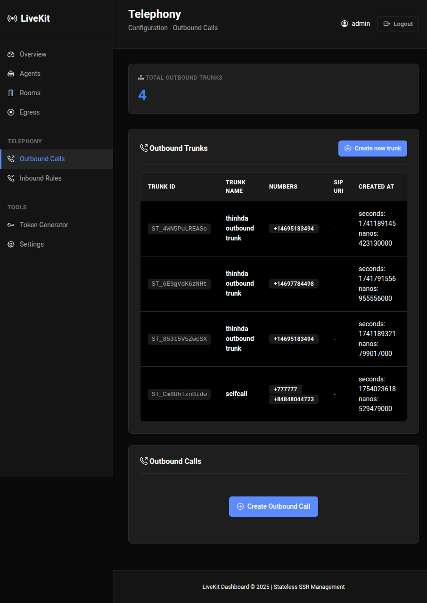
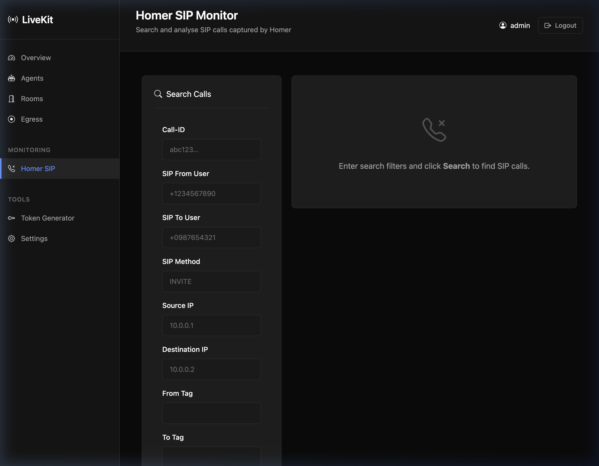
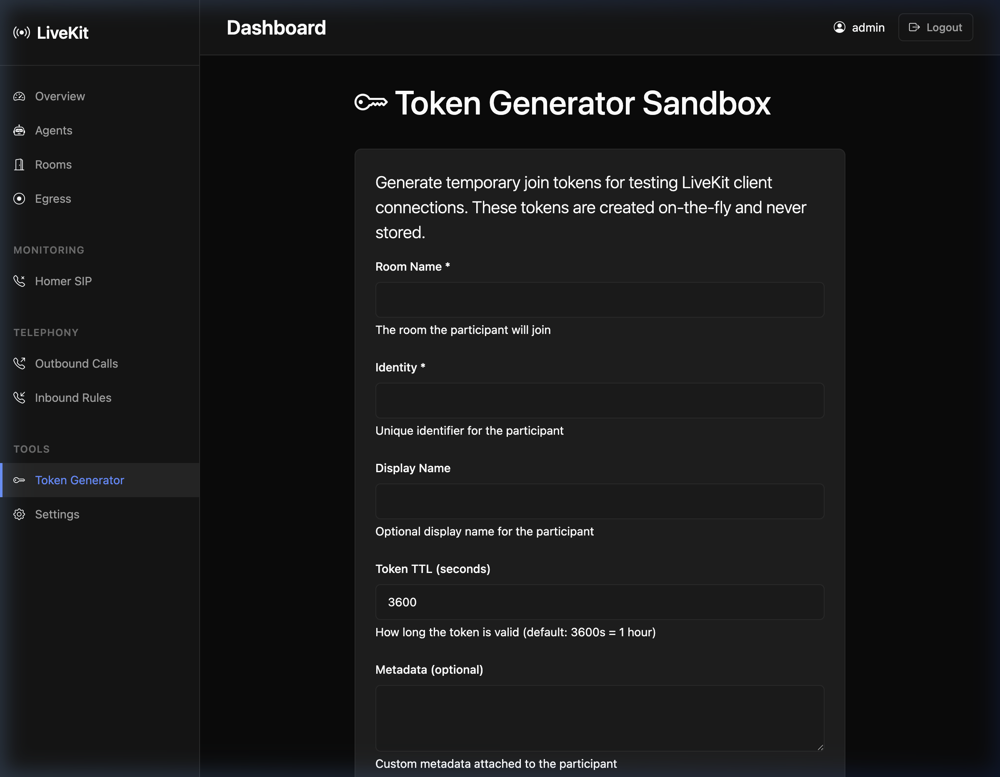
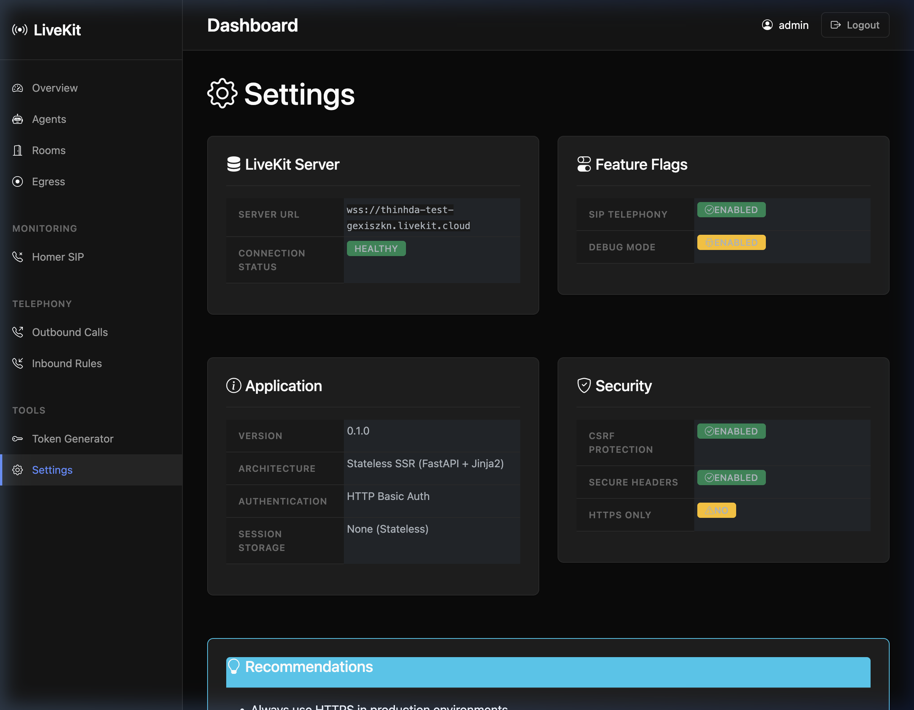

# LiveKit Dashboard

A **stateless**, self-hosted, server-side rendered dashboard for managing a private [LiveKit](https://livekit.io) server. Built with **FastAPI** and **Jinja2**, talking to LiveKit only through its official Python SDK — no database, no Redis, no background workers.

## Demo

[](./docs/video/demo.mp4)

A ~2-minute tour of the dashboard, recorded against a real LiveKit Cloud project: rooms, live participants, session history, egress, agent dispatch, the token sandbox, and settings. [Transcript](./docs/video/demo-transcript.md) · the recording script lives in [`scripts/demo/`](./scripts/demo/).

## Features



- **Overview** — server health, active rooms/participants, SDK latency, connection-success and platform analytics
- **Rooms** — list, create, and close rooms; live participant/track detail with RTC connection stats; pin, tag, and annotate rooms; CSV export
- **Session Summary** — read-only lifecycle timeline (joins/leaves/mutes) for any live or recently-ended room, plus its recordings
- **Egress** — start/stop composite, track, or web-capture recordings; view active jobs and storage usage
- **Ingress** — stream analytics and connection-quality metrics
- **Agents** — dispatch agents to rooms, fleet overview grouped by agent name, per-agent job status and success rate
- **SIP** *(optional)* — manage trunks, outbound/inbound calls and dispatch rules
- **Homer SIP Monitor** *(optional)* — search SIP calls captured by Homer/SIPCAPTURE, with ladder-diagram call flow, message inspection, and JSON export
- **Sandbox** — generate signed join tokens on the fly, with an HMAC verification helper
- **Settings** — read-only server config, masked credentials, and security status

Every page is server-rendered with HTMX for auto-refresh, protected by HTTP Basic Auth + CSRF, and reads live from the LiveKit API on each request — there's no cache to go stale.

## Quick Start

Requires Python 3.11+ and a LiveKit server (self-hosted or [LiveKit Cloud](https://cloud.livekit.io)).

```bash
git clone <repository-url> && cd livekit-dashboard
make install            # poetry install
make env-example        # creates .env — edit it with your LiveKit credentials
make dev                # http://localhost:8000, auto-reload
```

Prefer Docker? `make env-example`, edit `.env`, then `make docker-run` (wraps `docker-compose up -d`).

## Configuration

All configuration is via environment variables (`.env`):

| Variable             | Required | Default    | Description                                                       |
| -------------------- | :------: | ---------- | ------------------------------------------------------------------ |
| `LIVEKIT_URL`        | ✅        | —          | Self-hosted: `http://localhost:7880`; Cloud: `wss://your-project.livekit.cloud` |
| `LIVEKIT_API_KEY`    | ✅        | —          | LiveKit API key                                                   |
| `LIVEKIT_API_SECRET` | ✅        | —          | LiveKit API secret                                                 |
| `ADMIN_USERNAME`     | ✅        | `admin`    | Dashboard admin username                                          |
| `ADMIN_PASSWORD`     | ✅        | `changeme` | Dashboard admin password                                          |
| `APP_SECRET_KEY`     | ✅        | —          | Secret for CSRF/sessions — generate with `openssl rand -hex 32`   |
| `DEBUG`              | ❌        | `false`    | Enable debug mode                                                 |
| `HOST` / `PORT`      | ❌        | `0.0.0.0` / `8000` | Bind address                                               |
| `ENABLE_SIP`         | ❌        | `false`    | Enable SIP features                                               |
| `ENABLE_HOMER`       | ❌        | `false`    | Enable the Homer SIP Monitor tab                                   |
| `HOMER_URL` / `HOMER_USERNAME` / `HOMER_PASSWORD` | ❌* | — | Homer server + credentials |

\* Required when `ENABLE_HOMER=true`.

## Usage

Log in at `http://localhost:8000` with your admin credentials. Key pages:

| Page | Path | Highlights |
| --- | --- | --- |
| Rooms | `/rooms` |  Create/close rooms, drill into participants & tracks, pin/tag/annotate |
| Egress | `/egress` |  Start/stop recordings, view outputs and download URLs |
| Agents | `/agents` |  Fleet overview, per-agent job metrics, dispatch/delete |
| SIP | `/sip-outbound`, `/sip-inbound` |  Trunks, outbound calls, inbound dispatch rules (`ENABLE_SIP=true`) |
| Homer Monitor | `/homer` |  Call search, flow diagram, message/log inspection, JSON export (`ENABLE_HOMER=true`) |
| Sandbox | `/sandbox` |  Generate test tokens with custom permissions and TTL |
| Settings | `/settings` |  Server config, masked secrets, security status |

Full endpoint list below in [API Endpoints](#api-endpoints).

## Development

```bash
make help          # all available commands
make dev           # run with auto-reload
make test          # run tests (mocked LiveKit client, no real server needed)
make test-cov      # tests with coverage report
make lint          # Ruff + mypy
make fmt           # Black
make check         # lint + test
make demo-record   # record the README demo video against your real .env server
```

```
app/
├── main.py                 # FastAPI app entry point
├── routes/                 # one module per feature (rooms, egress, agents, sip, homer, ...)
├── services/
│   ├── livekit.py          # LiveKit SDK wrapper
│   └── homer.py            # Homer JWT auth + API client
├── security/                # HTTP Basic Auth, CSRF
├── templates/                # Jinja2 templates, one directory per feature
└── static/                   # CSS/JS
tests/                        # mocked LiveKit client — no real server required
scripts/demo/                 # records the README demo video against a real LiveKit server
```

## Security

- Always run behind HTTPS in production (reverse proxy with TLS — nginx, Caddy)
- Change the default admin credentials and generate a strong `APP_SECRET_KEY` (`openssl rand -hex 32`)
- Never commit `.env`; inject secrets via environment variables and rotate API keys regularly
- Security headers (HSTS, CSP, X-Frame-Options, etc.) are enabled by default — adjust CSP as needed
- Consider rate limiting at the reverse proxy if exposing this publicly

## Docker Deployment

```bash
docker build -t livekit-dashboard:latest .
docker run -d --name livekit-dashboard -p 8000:8000 \
  -e LIVEKIT_URL="https://your-server.com" \
  -e LIVEKIT_API_KEY="your-key" \
  -e LIVEKIT_API_SECRET="your-secret" \
  -e ADMIN_USERNAME="admin" \
  -e ADMIN_PASSWORD="secure-password" \
  -e APP_SECRET_KEY="$(openssl rand -hex 32)" \
  livekit-dashboard:latest
```

Or `docker-compose up -d` using the included `docker-compose.yml` (reads `.env`).

## API Endpoints

| Endpoint                           | Method | Description          | Auth Required |
| ---------------------------------- | ------ | --------------------- | :-----------: |
| `/`                                | GET    | Overview dashboard    | ✅ |
| `/rooms`                           | GET/POST | List / create rooms | ✅ |
| `/rooms/{name}`                    | GET    | Room details          | ✅ |
| `/rooms/{name}/summary`            | GET    | Session summary       | ✅ |
| `/rooms/{name}/delete`             | POST   | Delete room           | ✅ |
| `/rooms/{name}/token`              | POST   | Generate token        | ✅ |
| `/egress`                          | GET    | List egress jobs      | ✅ |
| `/egress/start`                    | POST   | Start egress          | ✅ |
| `/egress/{id}/stop`                | POST   | Stop egress           | ✅ |
| `/agents`                          | GET    | Agent fleet overview  | ✅ |
| `/agents/{name}`                   | GET    | Per-agent detail      | ✅ |
| `/agents/dispatch`                 | POST   | Create dispatch       | ✅ |
| `/agents/{id}/delete`              | POST   | Delete dispatch       | ✅ |
| `/sip-outbound`, `/sip-inbound`    | GET    | SIP pages             | ✅ |
| `/homer`, `/homer/call/{callid}`   | GET    | Homer SIP search/detail | ✅ |
| `/sandbox`                         | GET    | Token generator        | ✅ |
| `/settings`                        | GET    | Settings page          | ✅ |
| `/logout`                          | GET    | Logout page            | ❌ |
| `/health`                          | GET    | Health check           | ❌ |

## Contributing

1. Fork the repo and create a feature branch
2. `make check` (lint + test) before opening a PR
3. Follow existing patterns; add tests for new behavior

## License

MIT — see [LICENSE](./LICENSE).

## Acknowledgments

[LiveKit](https://livekit.io) · [FastAPI](https://fastapi.tiangolo.com) · [Bootstrap](https://getbootstrap.com) · [HTMX](https://htmx.org)
